# Reports

This guide is for anyone who reads or shares results from Digital.ai Testing: test leads, release managers, lab administrators and the people they report to. It describes every report the server can build, how to ask for one, the options that narrow it, where the finished file goes, and the settings that change that.

Ask for a report and the server builds it. It fetches the data, draws the charts and writes a short "What it means" under every section. You get one HTML file in Digital.ai branding that works offline and can be mailed or attached, and the AI sums up the highlights in the chat.

There are two kinds:

- **A ready-made report** for a common question, such as a test summary, a release readiness check or a license usage report. One request, one report.
- **A report of any data** you are looking at. The AI fetches the data with the ordinary tools and lays it out in the same design.

Asking for a report instead of having the AI assemble one also costs far fewer tokens; see [Optimizing Token Consumption](../README.md#optimizing-token-consumption) in the README.

**Contents**

- [Ready-made reports](#ready-made-reports)
  - [Test results](#test-results)
  - [Devices and the lab](#devices-and-the-lab)
  - [Usage and licenses](#usage-and-licenses)
  - [Performance](#performance)
- [A report of any data](#a-report-of-any-data)
- [How to ask](#how-to-ask)
- [Options you can add](#options-you-can-add)
- [Long ranges and background reports](#long-ranges-and-background-reports)
- [Where reports appear and are saved](#where-reports-appear-and-are-saved)
- [How the reports keep their numbers honest](#how-the-reports-keep-their-numbers-honest)
- [Settings](#settings)
- [Calling the tools directly](#calling-the-tools-directly)

---

## Ready-made reports

| Report | Ask for | Default range | Access | Example |
|---|---|---|---|---|
| [Test summary](#test-summary) | *"a test summary report"* | 7 days | Any | [Open](https://digitalai-opensource.github.io/digital-ai-testing-mcp/examples/reports/test-summary.html) |
| [Test trend](#test-trend) | *"a test trend report for the last 90 days"* | 90 days, up to 365 | Any | [Open](https://digitalai-opensource.github.io/digital-ai-testing-mcp/examples/reports/test-trend.html) |
| [Test breakdown](#test-breakdown) | *"test results by platform"* | 30 days, or all dates | Any | [Open](https://digitalai-opensource.github.io/digital-ai-testing-mcp/examples/reports/test-breakdown.html) |
| [Test reliability](#test-reliability) | *"which tests are unreliable?"* | 7 days, up to 31 | Any | [Open](https://digitalai-opensource.github.io/digital-ai-testing-mcp/examples/reports/test-reliability.html) |
| [Release readiness](#release-readiness) | *"are we ready to release?"* | 7 days, up to 31 | Any | [Open](https://digitalai-opensource.github.io/digital-ai-testing-mcp/examples/reports/release-readiness.html) |
| [Failure analysis](#failure-analysis) | *"why are tests failing?"* | 7 days | Any | [Open](https://digitalai-opensource.github.io/digital-ai-testing-mcp/examples/reports/failure-analysis.html) |
| [Test report inventory](#test-report-inventory) | *"how many test reports do we have?"* | All dates | Any; Cloud Admin covers every project | [Open](https://digitalai-opensource.github.io/digital-ai-testing-mcp/examples/reports/test-inventory.html) |
| [Device health](#device-health) | *"a device health report"* | 7 days of results | Any | [Open](https://digitalai-opensource.github.io/digital-ai-testing-mcp/examples/reports/device-health.html) |
| [Device coverage](#device-coverage) | *"which devices do our tests cover?"* | 30 days | Any | [Open](https://digitalai-opensource.github.io/digital-ai-testing-mcp/examples/reports/device-coverage.html) |
| [Device utilization](#device-utilization) | *"how much of the lab is used?"* | 30 days | Cloud Admin | [Open](https://digitalai-opensource.github.io/digital-ai-testing-mcp/examples/reports/device-utilization.html) |
| [License usage](#license-usage) | *"are we near our license limit?"* | 7 days, up to 31 | Cloud Admin | [Open](https://digitalai-opensource.github.io/digital-ai-testing-mcp/examples/reports/license-usage.html) |
| [Usage summary](#usage-summary) | *"a usage summary"* | 90 days | Cloud Admin | [One project](https://digitalai-opensource.github.io/digital-ai-testing-mcp/examples/reports/usage-summary.html) · [Every project](https://digitalai-opensource.github.io/digital-ai-testing-mcp/examples/reports/usage-overview.html) |
| [Performance overview](#performance-overview) | *"a performance overview report"* | 90 days, or all dates | Any | [Open](https://digitalai-opensource.github.io/digital-ai-testing-mcp/examples/reports/performance-overview.html) |

A project key sees its own project. A Cloud Admin key sees its own project by default and any project you name.

More ways to ask for each report: [example prompts](examples.md#ready-made-reports).

Every example is a real report built by the server from made-up data (no customer or tenant data), opened as a live
page: tabs, charts and the print layout work as they do for you. The HTML and a screenshot of each are in
[docs/examples/reports](examples/reports/); `npm run docs:example-reports` builds them again.

### Test results

#### Test summary

<a href="https://digitalai-opensource.github.io/digital-ai-testing-mcp/examples/reports/test-summary.html">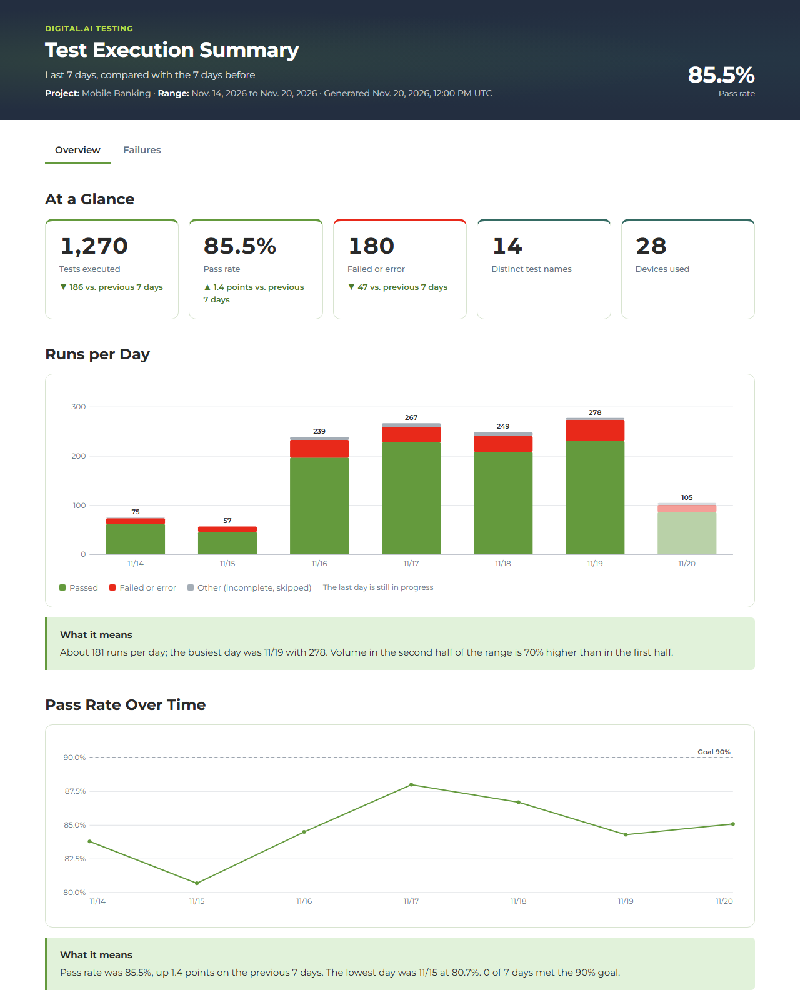</a>

*"Give me a test summary report for the last 7 days"*

The weekly status report: how many tests ran and how many passed.

- Runs and pass rate, against the period before
- Runs per day and pass rate over time
- Results by platform
- The most frequent failures
- How the platform classified the failures

It reads the runs themselves, at most 10,000 by default and 25,000 on request. When a busy project has more than that in the range, the report says at the top how many days it actually covers. For a long range use the [test trend](#test-trend), which counts every run.

Options: days, project, pass-rate goal, compare with the previous period (on by default).

#### Test trend

<a href="https://digitalai-opensource.github.io/digital-ai-testing-mcp/examples/reports/test-trend.html">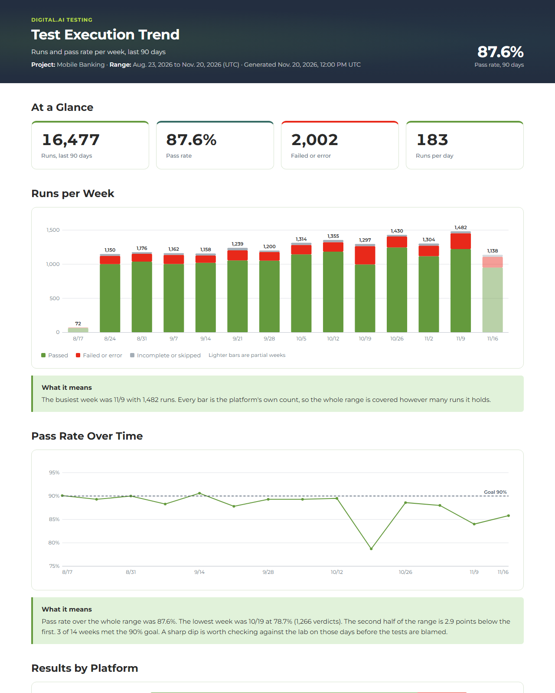</a>

*"Create a test trend report for the last 90 days"* · *"How has our pass rate moved this year?"*

Runs and pass rate over time, for ranges up to a year.

- Runs and pass rate per day (up to 31 days), per week (up to 182 days) or per month
- The lowest and highest periods, with the number of runs behind each
- Results by platform
- Failures by classification

It uses the platform's own counts, so it is exact for any range and any number of runs. A year of half a million runs takes about ten seconds.

Options: days, project, pass-rate goal, [scope](#scope-to-one-build-platform-or-column).

#### Test breakdown

<a href="https://digitalai-opensource.github.io/digital-ai-testing-mcp/examples/reports/test-breakdown.html">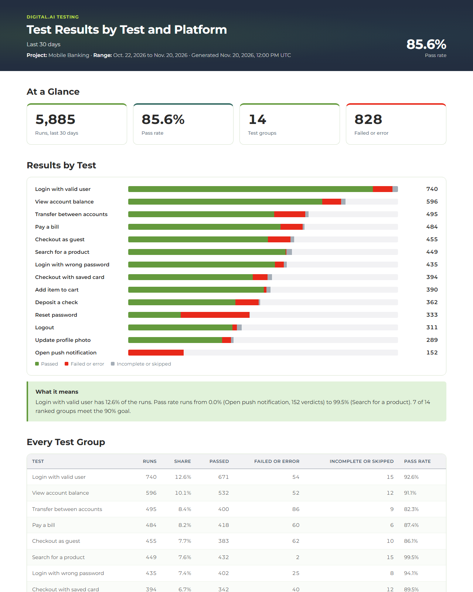</a>

*"Show test results by platform for the last 30 days"* · *"Compare pass rates by device model"* · *"Results by framework and platform"*

Results split by one or two things you choose.

- Runs, pass rate and failures per group, with every group in a table
- With two keys, a grid of failure rates of one against the other
- Groups with too few runs are listed but not ranked

You can break results down by platform, device, model, OS version, manufacturer, framework, browser, browser version, user, test, failure classification, device pool, or any custom column your tests add to their reports.

Options: what to break down by (required), days or all dates, project, pass-rate goal, [scope](#scope-to-one-build-platform-or-column).

#### Test reliability

<a href="https://digitalai-opensource.github.io/digital-ai-testing-mcp/examples/reports/test-reliability.html">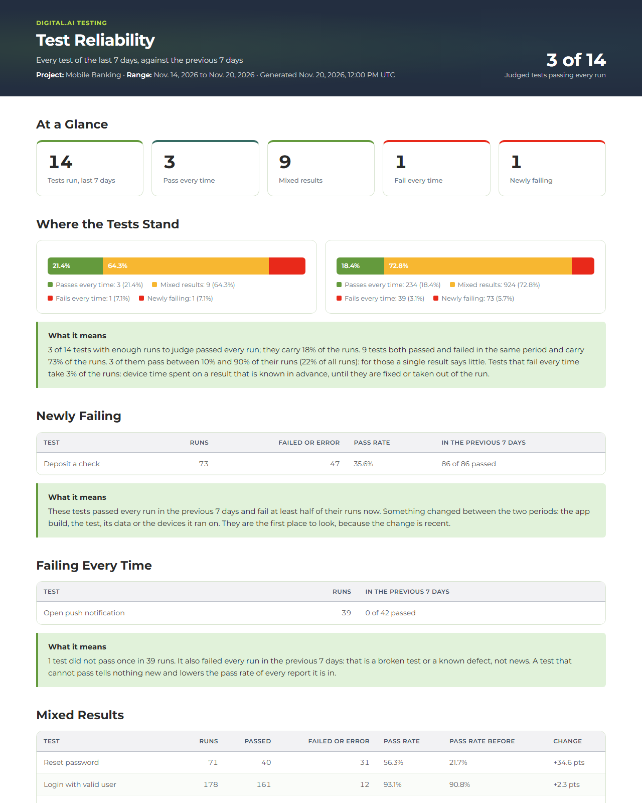</a>

*"Which tests are unreliable?"* · *"Which tests started failing this week?"*

Every test of the period, compared with the period before.

- Tests that pass every time, fail every time, or have mixed results (passed and failed in the same period)
- Newly failing tests: passed every run before, fail at least half now
- Recovered tests, and tests that stopped running
- A table of every test with its counts

No test is called flaky. The counts show that a test passes and fails; they cannot say why. A breakdown of one test by device or platform is the next step.

Options: days (up to 31), project, [scope](#scope-to-one-build-platform-or-column).

#### Release readiness

<a href="https://digitalai-opensource.github.io/digital-ai-testing-mcp/examples/reports/release-readiness.html">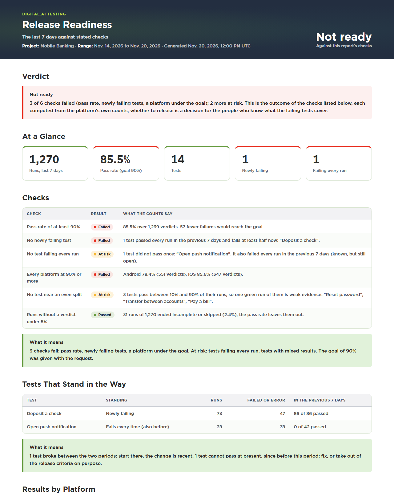</a>

*"Are we ready to release?"* · *"Create a release readiness report for build 412"*

A verdict of **Ready**, **Ready with risks** or **Not ready**, from six checks the report lists in full:

1. Pass rate at or above your goal (95% unless you give another)
2. No newly failing test
3. No test failing every run
4. Every platform at the goal
5. No test passing between 10% and 90% of its runs
6. Fewer than 5% of runs without a verdict

Then the tests that stand in the way, results by platform and failures by classification. With fewer than 20 verdicts the report gives no verdict.

The verdict is the outcome of those checks. Whether to release remains a decision for the people who know what the failing tests cover, and the report says so.

Options: days (up to 31), project, pass-rate goal, [scope](#scope-to-one-build-platform-or-column) to one build.

#### Failure analysis

<a href="https://digitalai-opensource.github.io/digital-ai-testing-mcp/examples/reports/failure-analysis.html">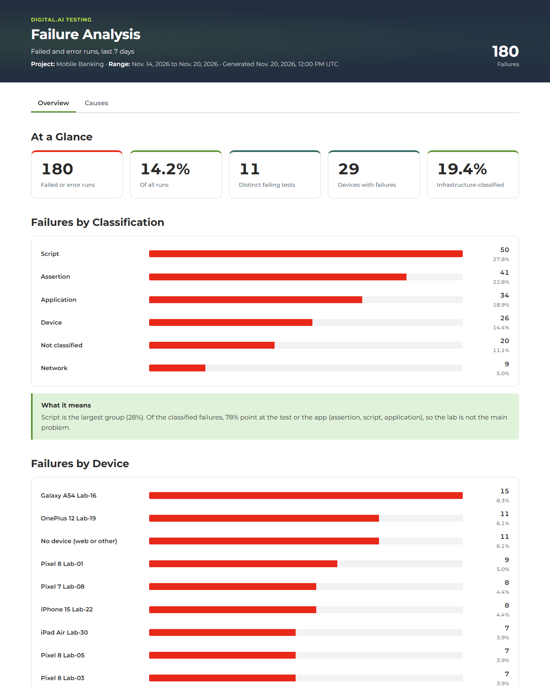</a>

*"Why are tests failing this week? Make a failure analysis report"*

- Failures by classification and by device
- A device-by-day heatmap
- The most common causes, each with an example test

Options: days, project.

#### Test report inventory

<a href="https://digitalai-opensource.github.io/digital-ai-testing-mcp/examples/reports/test-inventory.html">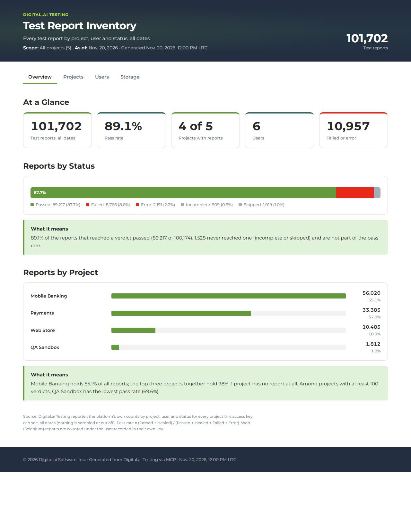</a>

*"Create a test report inventory"* · *"How many test reports do we have, by project and user?"*

Every test report on the instance, whatever its date.

- Reports and pass rate per project, with a table of every project
- Reports per user
- Storage per project against its quota, and projects over quota
- Projects that exist only in the reporter

It uses the platform's own counts, so millions of reports are covered in well under a minute with nothing sampled.

Options: project (to limit it to one).

### Devices and the lab

#### Device health

<a href="https://digitalai-opensource.github.io/digital-ai-testing-mcp/examples/reports/device-health.html">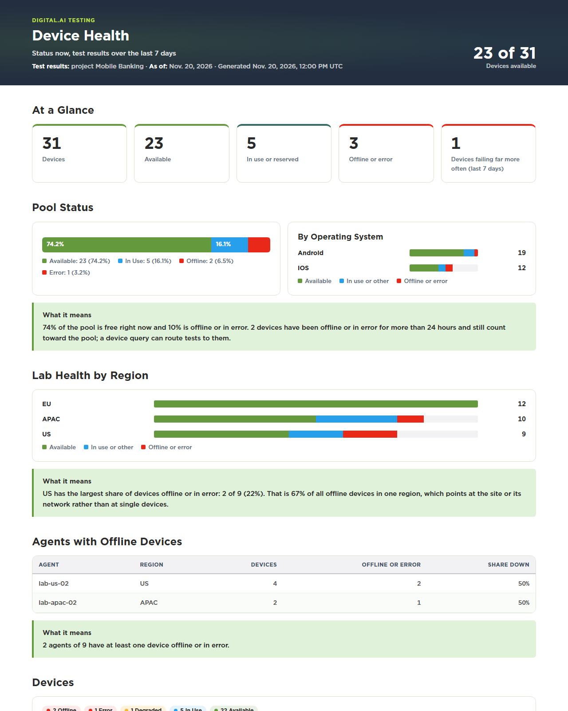</a>

*"Show me a device health report"*

- Pool status and devices by operating system
- Status tiles, worst first
- Devices offline for more than a day
- Devices that fail tests far more often than the rest of the pool
- Offline devices by region and by agent (host machine), naming an agent whose every device is down

Options: days and project (these scope the test results only; the pool is every device your key sees).

#### Device coverage

<a href="https://digitalai-opensource.github.io/digital-ai-testing-mcp/examples/reports/device-coverage.html">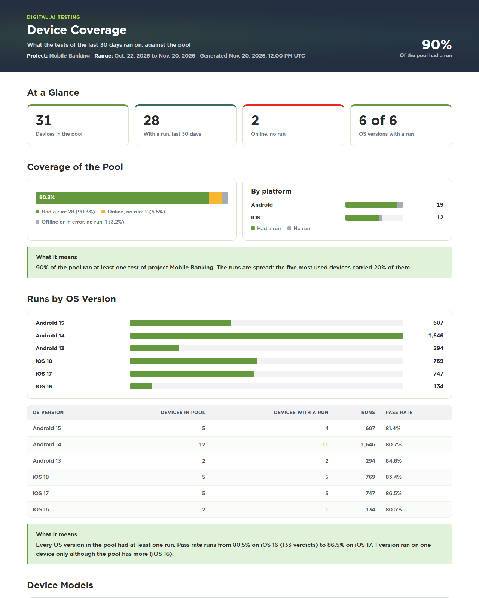</a>

*"Which devices and OS versions do our tests cover?"*

What your tests ran on, set against the pool.

- Devices with and without a test run, online ones first
- Runs and pass rate by OS version and by model
- OS versions the pool has that no test ran on
- How concentrated the runs are on a few devices

The runs are one project's. A device with no run here may still be in use by another project; the [device utilization](#device-utilization) report answers that for the whole lab.

Options: days, project.

#### Device utilization

<a href="https://digitalai-opensource.github.io/digital-ai-testing-mcp/examples/reports/device-utilization.html">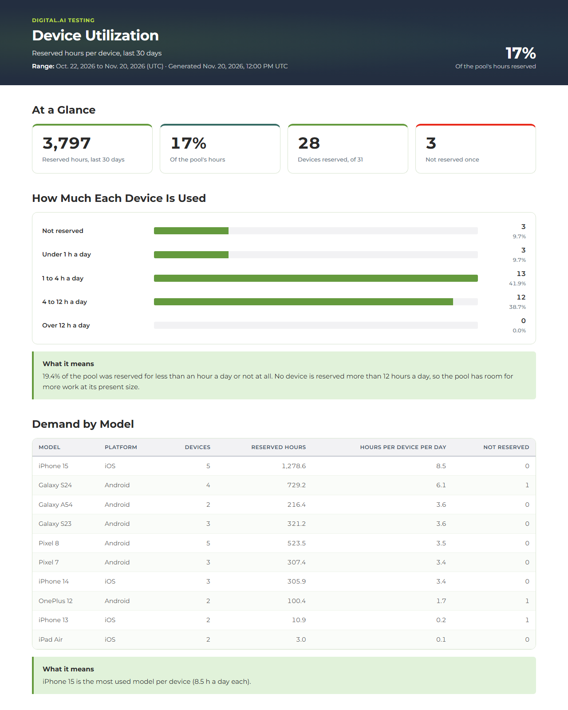</a>

*"How much of our device lab is used?"* · *"Which devices are never reserved?"*

Reserved hours per device against the hours the pool had, across every project.

- Share of the pool's hours in use
- Devices by hours used per day, from never reserved to more than twelve hours
- Demand by model, OS version and region
- Most used devices, and devices never reserved

Options: days, project. Cloud Admin.

### Usage and licenses

#### License usage

<a href="https://digitalai-opensource.github.io/digital-ai-testing-mcp/examples/reports/license-usage.html">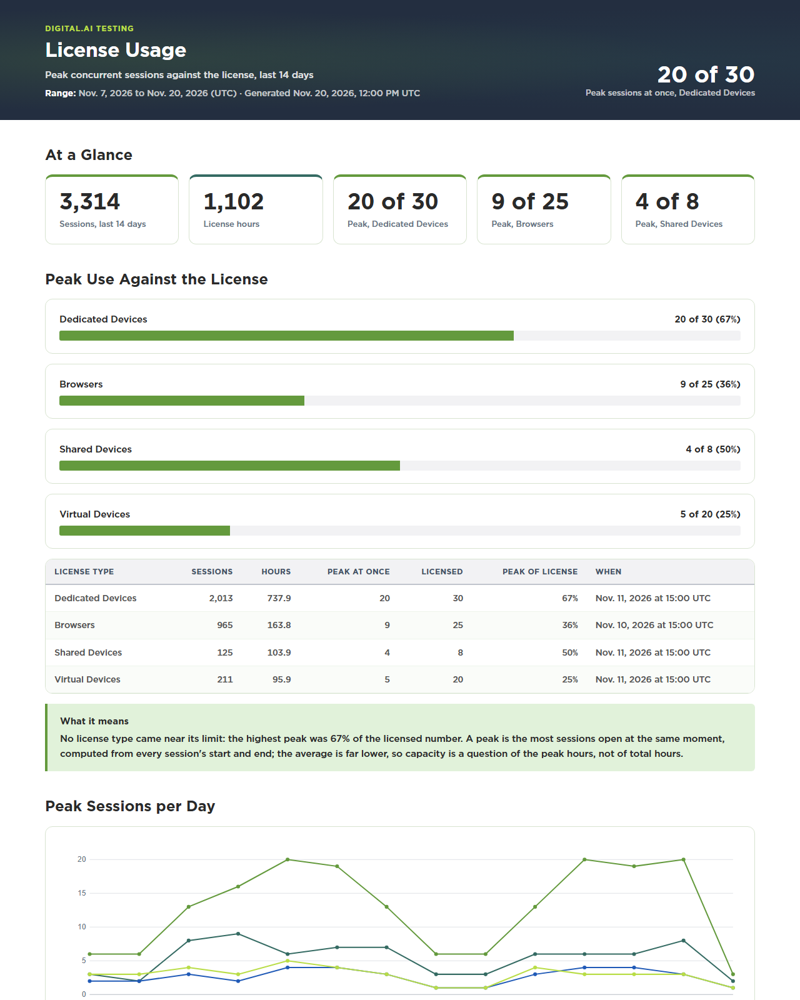</a>

*"Are we near our license limit?"* · *"What was our peak concurrency this month?"*

The most sessions open at the same moment, per license type, against the number you are licensed for.

- Peak per license type, with the day and hour it happened
- Peaks per day
- What the licenses are used for: automated runs, manual testing, development
- The busiest hours of the day
- Use by project

The peaks are exact. They are computed from the start and end of every session in the range.

Options: days (up to 31). Covers every project. Cloud Admin.

#### Usage summary

<a href="https://digitalai-opensource.github.io/digital-ai-testing-mcp/examples/reports/usage-summary.html">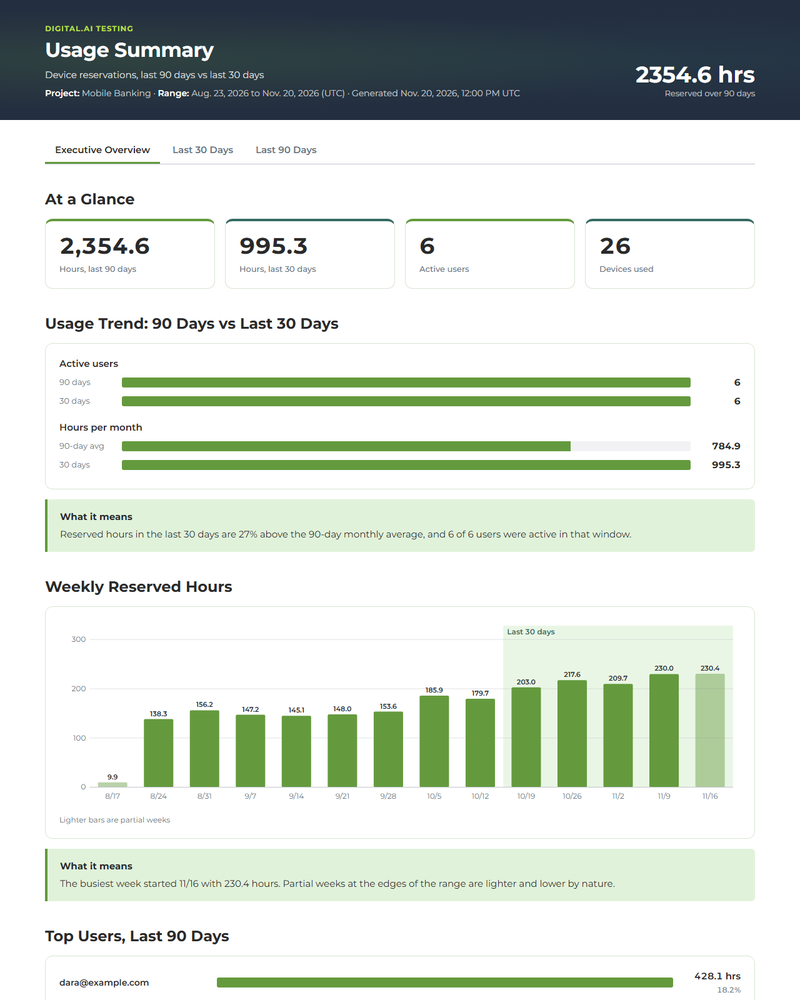</a>

*"Create a usage summary for project Payments for the last 90 days"* · *"Create a usage summary for all projects"*

Reserved device hours.

- **With a project:** hours and active users, weekly hours with the recent weeks shaded, top users and top devices
- **Without one:** an overview of every project, with hours by project, device and platform, a table of every project, and hours by user tag (for chargeback) for ranges up to 31 days

Options: days, project, recent window. Cloud Admin.

### Performance

#### Performance overview

<a href="https://digitalai-opensource.github.io/digital-ai-testing-mcp/examples/reports/performance-overview.html">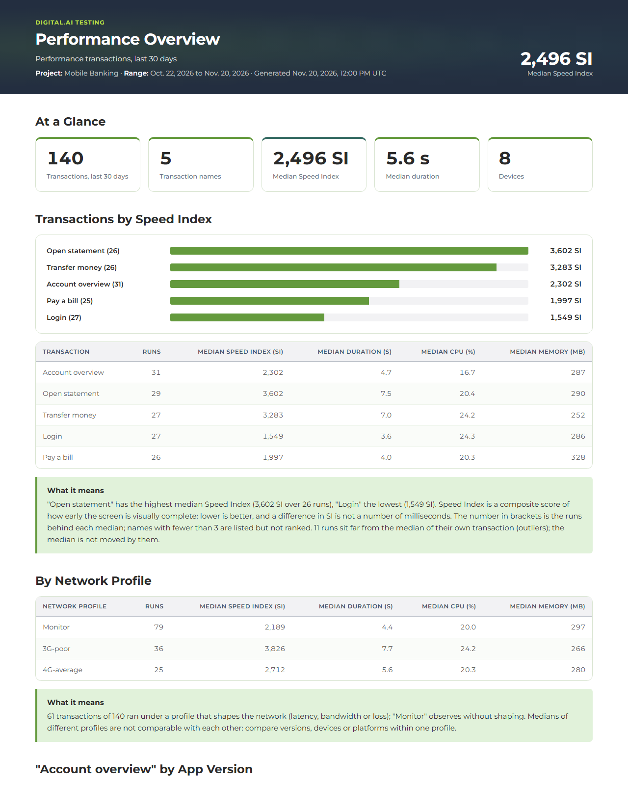</a>

*"Create a performance overview report"* · *"Which transactions are slowest?"*

Performance transactions recorded by your tests.

- Median Speed Index, duration, CPU and memory per transaction
- The same by network profile and by platform
- App versions of the most-run transaction, in version order
- Transactions over time
- What the data can support: runs with no Speed Index, runs with no telemetry, transactions with too few runs

Speed Index is a score, lower is better. The report never turns a difference in Speed Index into milliseconds.

For a like-for-like comparison of two versions, devices or networks, ask the AI to compare them; see [Performance Comparison Reports](../README.md#performance-comparison).

Options: days or all dates, project.

---

## A report of any data

<a href="https://digitalai-opensource.github.io/digital-ai-testing-mcp/examples/reports/any-data.html">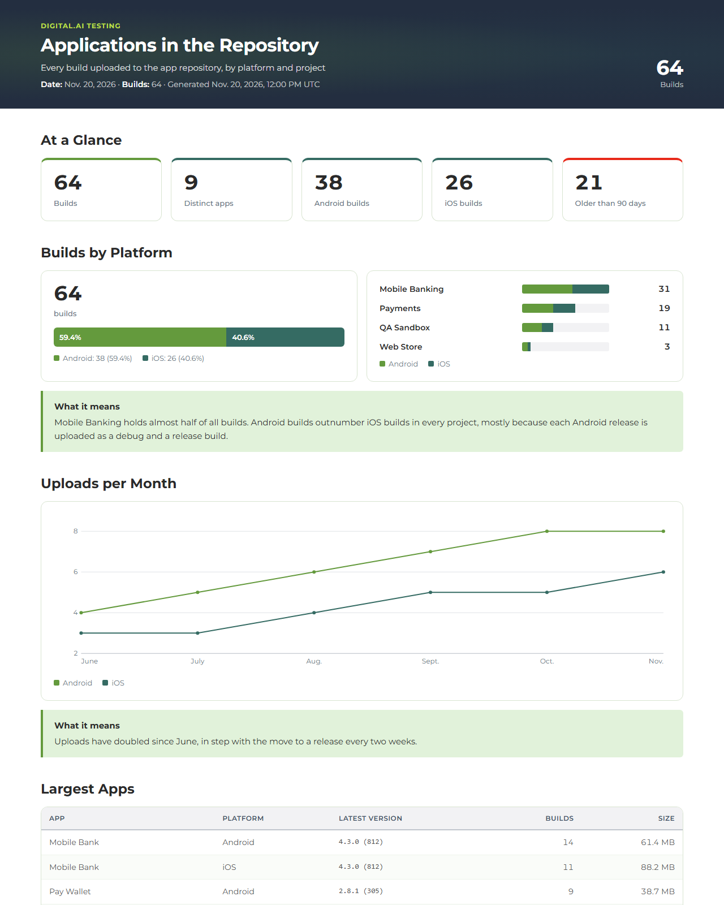</a>

The ready-made reports cover common questions. For anything else, ask for a report of whatever you are looking at:

- *"List the applications in the repository"*, then *"Show that as a report by platform"*
- *"Make a report of these reservations by user"*
- *"Show the agents and their devices as a report"*

The AI fetches the data with the ordinary tools and sends the numbers and its interpretation to `render_report`, which lays them out in the same design as the ready-made reports.

When a tool returns more than a handful of records, its result includes one line telling the AI that the data can be presented as a report. That is how the AI knows the option exists without being told. Where a ready-made report already covers that data, the line names it instead, so the AI does not rebuild it by hand.

### Building blocks

A report is made of sections. Each section holds one or more of these blocks, and a "What it means" note.

| Block | Use it for |
|---|---|
| KPI cards | The few numbers that matter most |
| Share bar | Parts of a whole, such as passed against failed |
| Bar chart | Comparing groups; stacked or side by side, with an optional goal line |
| Line chart | A trend over many points |
| Compare | One period against another |
| Meter | Use against a limit |
| Heatmap | Two dimensions at once, such as device by day |
| Calendar | Daily activity |
| Status tiles | Devices or agents, worst first |
| Timeline | Events in order |
| Table | The detail behind a chart |
| Callout | A finding, a note, a warning or a risk |
| Findings | A short list of conclusions |
| Text | A paragraph |

Reports can have tabs, a headline figure, and a source line.

If the AI's layout is nearly right, the report is drawn anyway. A field name such as `labels` is read as the one the block expects, a setting the format does not know is left out, and the answer tells the AI what was changed. Only a layout with nothing to draw is refused.

---

## How to ask

Use plain language. You do not need a tool name.

- *"Give me a test summary report for the last 7 days"*
- *"Are we ready to release build 412?"*
- *"Which tests started failing this week?"*
- *"Are we near our license limit? Use the last 30 days."*
- *"List the applications in the repository"*, then *"Show that as a report by platform"*

Add a project, a number of days or a pass-rate goal to any request: *"...for project Payments, last 30 days, against a 95% goal"*.

A quick question still gets a quick answer. *"How many devices are offline?"* is answered in a sentence. Say "report" when you want something to read or share.

---

## Options you can add

| Option | What it does | Example |
|---|---|---|
| **Days** | The length of the range | *"...for the last 30 days"* |
| **Project** | Limits the report to one project | *"...for project Payments"* |
| **Pass-rate goal** | Draws a goal line, or is the bar for release readiness | *"...against a 95% goal"* |
| **All dates** | Everything on record (test breakdown, performance overview) | *"...for all dates"* |
| **Compare** | Compares with the period before (test summary, test reliability) | on by default |
| **Scope** | Counts only part of the runs | see below |
| **Title** | Your own report title | *"...titled Q4 Quality Review"* |
| **Save to** | A full path to save the file to | *"...save it to C:\Reports\q4.html"* |

### Scope to one build, platform or column

The test trend, test breakdown, test reliability and release readiness reports can count only the runs that match a value:

- *"Create a release readiness report for build 412"*
- *"Show the test trend for iOS only"*
- *"Results by device model, Appium Server tests only"*

Any column on your test reports can be used, including custom ones your tests add (for example a build number). The scope is named at the top of the report and in its source line. A test breakdown by that column lists the values it holds.

- **Letter case does not matter.** The platform keeps each value in the spelling the test client sent, so one browser can be stored as "Chrome" and as "chrome"; a scope of "chrome" counts both. Ask for the exact spelling only and the report counts that one and says the other spellings are left out.
- **A custom column named like a plain word.** Plain words such as platform, device, model, framework, browser, user, test or category stand for the platform's own columns. If your tests add a column with one of those names, ask for the column name as written and the report uses your column.
- **A user.** A report scoped to a user counts that user's mobile runs only, and says that web (Selenium) runs are not included: the platform records their user in a separate column. Asking for the user's test counts directly, without a report, counts both.

### Your own interpretation

Every section carries a generated "What it means". To replace one, say so: *"Reword the platform section to say the iOS drop is the login change."* The AI swaps the text without fetching the data again.

---

## Long ranges and background reports

Every request first measures how long the report will take, in a few seconds and without doing the work.

Most reports take 5 to 30 seconds. If the estimate is longer than a tool call can wait (45 seconds by default), nothing runs. The AI tells you the estimate and offers two choices:

- a smaller range that fits, or
- the full report **in the background**.

A background report runs inside the server. You can keep working, ask for its progress, or cancel it. When it is done, the next answer from the AI says so and delivers it like any other report. Waiting costs no AI tokens. Background reports stop if the AI client closes the server.

This mostly applies to a usage summary of one busy project over many months, and to a test summary of a very busy project.

---

## Where reports appear and are saved

**In Claude Desktop the report appears inside the conversation.** It is drawn under the AI's tool call, with **Download** and **Full screen** buttons. You need no folder, and the AI does not copy or rewrite the file. Download asks you where to save it. If a report folder is set, a copy is saved there as well.

**In AI clients that do not show such views** (Claude Code and other coding agents), the report is a file:

| You have | What happens |
|---|---|
| **A report folder**, set once with [`setup reports <folder>`](../README.md#the-setup-command) or `MCP_REPORT_DIR` | Saved there in seconds; the AI tells you the path |
| **A project folder the client works in** | Saved in its `digital-ai-reports/` folder, which carries its own `.gitignore` so a report is never committed |
| Neither | A temporary file that the AI copies to where it keeps your files. An AI that cannot reach it asks whether to add a folder or to write the report out in the chat (about a minute, and the tokens of the whole file; see [Optimizing Token Consumption](../README.md#ask-for-finished-work-not-raw-data)) |

A path you name in the request always works, in every client.

No browser or other app is opened, and nothing is written into your personal folders unless you choose a folder for reports. Files in the temporary folder (`digital-ai-testing-reports` in your system's temp folder) are removed after a day. Under Docker the container's disk is not yours: reports come back to the AI to save, unless `MCP_REPORT_DIR` points at a mounted folder.

---

## How the reports keep their numbers honest

The ready-made reports follow the same rules, so a number means the same thing in each.

**What was counted**

- Every report states its source, its range and its scope in a source line at the bottom.
- Reports built from the platform's own counts (trend, breakdown, reliability, readiness, inventory) cover every run in the range. Nothing is sampled.
- A report that reads individual runs and has to stop at its limit says at the top how many days it actually covers.
- When a report joins two things with different scopes, it says so. Device coverage, for example, sets one project's runs against every device your key can see.

**Rates and rankings**

- Pass rate = (Passed + Healed) / (Passed + Healed + Failed + Error). Incomplete and skipped runs are shown and left out of the rate.
- Every rate is shown with the number of runs behind it.
- A group with fewer than 20 verdicts is listed but never ranked or called lowest. A test is judged from 3 verdicts. A median needs 3 runs.
- A share is never printed as 0% when it is small, or as 100% when it is not everything.

**What a report will not claim**

- No test is called flaky. Mixed results are reported as mixed results.
- When most failures are unclassified, a failure report gives the split of the rest and no verdict on whether the lab or the tests are at fault.
- A release readiness verdict is the outcome of its stated checks, not a decision.
- Speed Index is a score. A difference in Speed Index is never restated as time saved.
- Medians of different network profiles, or of different platforms, are shown but not compared with each other.

**Names and days**

- Test names that differ only in run ids, dates or run numbers count as one test.
- Test reports use days in the server's time zone. Usage, license and trend reports use UTC days, as the platform does, and say so.

---

## Settings

| Setting | What it does | Set it with |
|---|---|---|
| Report folder | Where finished reports are saved | `setup reports <folder>`, or `MCP_REPORT_DIR` in the client configuration |
| Report pointer | The line on a large result telling the AI the data can be presented as a report. On by default | `setup options report-pointer off`, or `MCP_REPORT_POINTER=false` |
| Wait limit | How long a report may take before it is offered as a background report. 45 seconds by default | `MCP_REPORT_SYNC_LIMIT_MS` in the client configuration |
| Toolsets | With a reduced tool list, `create_report` and `render_report` are always loaded, and each ready-made report still runs on its first call | `setup options toolsets <names>`, or `MCP_TOOLSETS` |

See [the setup command](../README.md#the-setup-command) and [Configuration](../README.md#configuration) in the README.

---

## Calling the tools directly

You do not need tool names to ask for a report. They matter when you write instructions for an agent or read a tool list.

**One tool builds every ready-made report:** `create_report` with a `recipe`. Each recipe also has a tool of its own, named the way people ask.

| Recipe | Its own tool | Parameters beyond `projectName`, `title`, `outputPath` |
|---|---|---|
| `test-summary` | `create_test_summary_report` | `days`, `passRateGoal`, `compare`, `maxRecords`, `background` |
| `test-trend` | `create_test_trend_report` | `days`, `passRateGoal`, `where`, `exactCase`, `keysAsWritten` |
| `test-breakdown` | `create_test_breakdown_report` | `groupBy` (required), `days`, `allDates`, `passRateGoal`, `where`, `exactCase`, `keysAsWritten` |
| `test-reliability` | `create_test_reliability_report` | `days`, `compare`, `where`, `exactCase`, `keysAsWritten` |
| `release-readiness` | `create_release_readiness_report` | `days`, `passRateGoal`, `where`, `exactCase`, `keysAsWritten` |
| `failure-analysis` | `create_failure_analysis_report` | `days`, `maxRecords`, `background` |
| `test-inventory` | `create_test_inventory_report` | none |
| `device-health` | `create_device_health_report` | `days`, `maxRecords`, `background` |
| `device-coverage` | `create_device_coverage_report` | `days` |
| `device-utilization` | `create_device_utilization_report` | `days` |
| `license-usage` | `create_license_usage_report` | `days` (no `projectName`) |
| `usage-summary` | `create_usage_summary_report` | `days`, `recentDays`, `background` |
| `performance-overview` | `create_performance_overview_report` | `days`, `allDates` |

Examples:

```json
{ "recipe": "test-summary", "days": 7, "passRateGoal": 95 }
```

```json
{ "recipe": "test-breakdown", "groupBy": ["platform", "framework"], "days": 30 }
```

```json
{ "recipe": "release-readiness", "where": { "digitalai:build": "412" }, "passRateGoal": 98 }
```

`groupBy` takes one or two of: `platform`, `device`, `model`, `os version`, `manufacturer`, `framework`, `browser`, `browser version`, `user`, `test`, `classification` (or `category`), `pool`, `day`, or a report column as written, such as `digitalai:build`.

`where` takes the same names, each with the value to match. The value is the whole stored value, in any letter case: the platform keeps each value in the spelling the test client sent, so one browser can be stored as "Chrome" and as "chrome", and `{ "browser": "chrome" }` counts both. Add `"exactCase": true` to count only the spelling you wrote; the report then says that other spellings are left out. Groups in a report are always shown with such spellings merged.

If your tests add a column of their own whose name is one of those plain words (a column called `category` or `platform`, for example), add `"keysAsWritten": true`: the names in `groupBy` and `where` are then sent to the platform exactly as written and your column is used.

A report scoped to a `user` counts that user's mobile runs only and says that web (Selenium) runs are not included; web runs record their user in a separate column. `get_grouped_test_reports` with a user filter counts both.

`create_report` also handles what the per-report tools do not:

- `background: true` starts a long report as a background job and returns a `jobId`
- `jobId` returns the status of a job, or the finished report; with `cancel: true` it stops the job
- `runId` with `whatItMeans` replaces the interpretation of a section without fetching again

**A report of any data:** `render_report` with a `spec`:

```json
{
  "spec": {
    "title": "Application Repository by Platform",
    "sections": [
      { "title": "At a Glance", "blocks": [
        { "type": "kpis", "items": [ { "value": 408, "label": "Builds" } ] } ] },
      { "title": "Builds by Platform",
        "whatItMeans": "Android builds are the larger group.",
        "blocks": [
          { "type": "share", "parts": [ { "label": "Android", "value": 250 }, { "label": "iOS", "value": 158 } ] } ] }
    ],
    "source": "Source: list_applications."
  }
}
```

The full field list for every block is in the tool's own description and in [docs/tools.md](tools.md).
